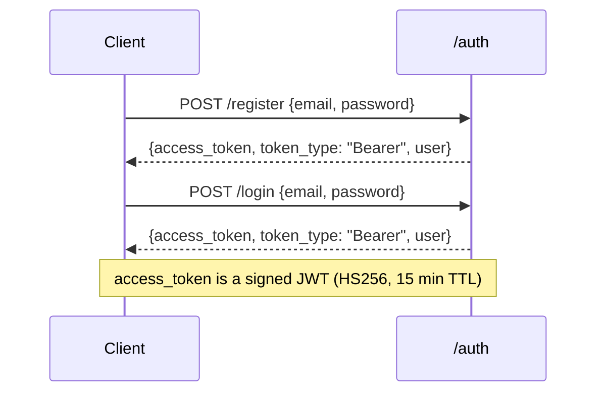
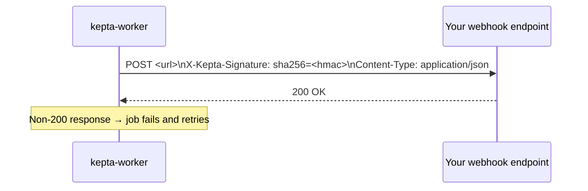

# API Reference

## Base URL

```
https://app.kepta.app/api/v1          # hosted
https://<your-domain>/api/v1          # self-hosted
```

A machine-readable OpenAPI 3.1 schema is served at `/openapi.json` and rendered at `/scalar` (Scalar UI) and `/redoc` (ReDoc).

## Authentication

All endpoints except `/api/v1/auth/register`, `/api/v1/auth/login`, and `/health` require a `Bearer` token.

```
Authorization: Bearer <access_token>
```

### Token flow



Access tokens are HS256 JWTs containing:

| Claim | Value |
|-------|-------|
| `sub` | User UUID |
| `email` | User email |
| `iat` | Issued-at (Unix timestamp) |
| `exp` | Expiry (iat + 900 seconds) |

## Error Format

All errors follow [RFC 9457](https://www.rfc-editor.org/rfc/rfc9457) Problem Details (`application/problem+json`).

```json
{
  "type": "about:blank",
  "title": "Unprocessable Entity",
  "status": 422,
  "detail": "email: invalid email address"
}
```

Common status codes:

| Code | Meaning |
|------|---------|
| 400 | Validation error (bad request body) |
| 401 | Missing or invalid JWT |
| 403 | Authenticated but not a member of the requested household |
| 402 | Free tier limit reached (upgrade required) |
| 404 | Resource not found |
| 422 | Semantic validation error |
| 500 | Internal server error |

## Endpoints

### Auth

| Method | Path | Description |
|--------|------|-------------|
| `POST` | `/auth/register` | Create account, receive access token |
| `POST` | `/auth/login` | Authenticate, receive access token |
| `POST` | `/auth/logout` | Invalidate session |
| `POST` | `/auth/refresh` | Exchange refresh token for new access token |
| `GET` | `/auth/oauth/{provider}` | Begin OAuth flow (`google`, `apple`) |
| `GET` | `/auth/oauth/{provider}/callback` | OAuth callback |

**POST /auth/register**
```json
// Request
{ "email": "user@example.com", "password": "min-12-chars" }

// Response 200
{
  "access_token": "<jwt>",
  "token_type": "Bearer",
  "user": { "id": "<uuid>", "email": "user@example.com", "display_name": null }
}
```

### Users

| Method | Path | Description |
|--------|------|-------------|
| `GET` | `/users/me` | Get own profile |
| `PATCH` | `/users/me` | Update display name or avatar |
| `DELETE` | `/users/me` | Delete account |

### Households

| Method | Path | Description |
|--------|------|-------------|
| `GET` | `/households` | List households you are a member of |
| `POST` | `/households` | Create a household (you become owner) |
| `GET` | `/households/{id}` | Get household details |
| `PATCH` | `/households/{id}` | Update name / address |
| `DELETE` | `/households/{id}` | Delete household (owner only) |
| `GET` | `/households/{id}/members` | List members |
| `POST` | `/households/{id}/members/invite` | Invite a user by email |
| `DELETE` | `/households/{id}/members/{user_id}` | Remove a member |

### Rooms

| Method | Path | Description |
|--------|------|-------------|
| `GET` | `/households/{id}/rooms` | List rooms |
| `POST` | `/households/{id}/rooms` | Create room |
| `PATCH` | `/households/{id}/rooms/{room_id}` | Update room |
| `DELETE` | `/households/{id}/rooms/{room_id}` | Delete room |

### Items

| Method | Path | Description |
|--------|------|-------------|
| `GET` | `/households/{id}/items` | List items |
| `POST` | `/households/{id}/items` | Create item |
| `GET` | `/households/{id}/items/{item_id}` | Get item |
| `PATCH` | `/households/{id}/items/{item_id}` | Update item |
| `DELETE` | `/households/{id}/items/{item_id}` | Delete item |

**POST /households/{id}/items — request body**
```json
{
  "name": "HVAC Unit",
  "category": "system",
  "brand": "Carrier",
  "model_number": "24ACC636A003",
  "serial_number": "1234ABC",
  "purchase_date": "2021-06-15",
  "warranty_expiry": "2031-06-15",
  "room_id": null
}
```

### Maintenance Schedules

| Method | Path | Description |
|--------|------|-------------|
| `GET` | `/households/{id}/schedules` | List all schedules |
| `POST` | `/households/{id}/schedules` | Create schedule |
| `PATCH` | `/households/{id}/schedules/{schedule_id}` | Update schedule |
| `DELETE` | `/households/{id}/schedules/{schedule_id}` | Delete schedule |
| `POST` | `/households/{id}/schedules/{schedule_id}/complete` | Mark completed |

**POST /households/{id}/schedules — request body**
```json
{
  "item_id": "<uuid>",
  "title": "Replace HVAC filter",
  "frequency_unit": "month",
  "frequency_value": 3,
  "next_due_at": "2026-09-01"
}
```

### Documents

| Method | Path | Description |
|--------|------|-------------|
| `GET` | `/households/{id}/documents` | List documents |
| `POST` | `/households/{id}/documents` | Upload document (multipart/form-data) |
| `GET` | `/households/{id}/documents/{doc_id}` | Get document metadata |
| `PATCH` | `/households/{id}/documents/{doc_id}` | Update title / type |
| `DELETE` | `/households/{id}/documents/{doc_id}` | Delete document |
| `GET` | `/households/{id}/documents/{doc_id}/download` | Get presigned S3 download URL |

Upload uses `multipart/form-data` with fields: `file` (binary), `title` (text), `type` (text), `item_id` (optional UUID).

### Service Provider Contacts

| Method | Path | Description |
|--------|------|-------------|
| `GET` | `/households/{id}/contacts` | List contacts |
| `POST` | `/households/{id}/contacts` | Create contact |
| `PATCH` | `/households/{id}/contacts/{contact_id}` | Update contact |
| `DELETE` | `/households/{id}/contacts/{contact_id}` | Delete contact |

### Notifications / Webhooks

| Method | Path | Description |
|--------|------|-------------|
| `GET` | `/households/{id}/notifications` | List webhook subscriptions |
| `POST` | `/households/{id}/notifications` | Create webhook subscription |
| `PATCH` | `/households/{id}/notifications/{webhook_id}` | Update webhook |
| `DELETE` | `/households/{id}/notifications/{webhook_id}` | Delete webhook |

### Subscriptions

| Method | Path | Description |
|--------|------|-------------|
| `GET` | `/subscriptions/plans` | List available plans |
| `GET` | `/subscriptions/current` | Get current subscription |
| `POST` | `/subscriptions/checkout` | Start Stripe checkout |
| `POST` | `/subscriptions/portal` | Open Stripe billing portal |

## Webhook Payloads

All webhook deliveries include an `X-Kepta-Signature` header containing `sha256=<hex>` where the hex value is the HMAC-SHA256 of the raw request body using the webhook's secret.



**Payload envelope**
```json
{
  "event": "maintenance.due",
  "household_id": "<uuid>",
  "timestamp": "2026-06-22T10:00:00Z",
  "data": { ... }
}
```

| Event | `data` shape |
|-------|-------------|
| `maintenance.due` | `{schedule_id, item_id, title, next_due_at}` |
| `maintenance.overdue` | `{schedule_id, item_id, title, next_due_at, days_overdue}` |
| `document.uploaded` | `{document_id, title, type, uploaded_by}` |
| `member.invited` | `{user_id, email, role}` |
| `member.joined` | `{user_id, email}` |
| `warranty.expiring` | `{item_id, item_name, warranty_expiry, days_remaining}` |
| `subscription.expiring` | `{plan, current_period_end, days_remaining}` |

## Pagination

Collection endpoints support cursor-based pagination:

```
GET /api/v1/households/{id}/items?after=<cursor>&limit=50
```

Response includes a `next_cursor` field (null when no more pages):
```json
{
  "data": [...],
  "next_cursor": "<opaque-string>",
  "total": 142
}
```
