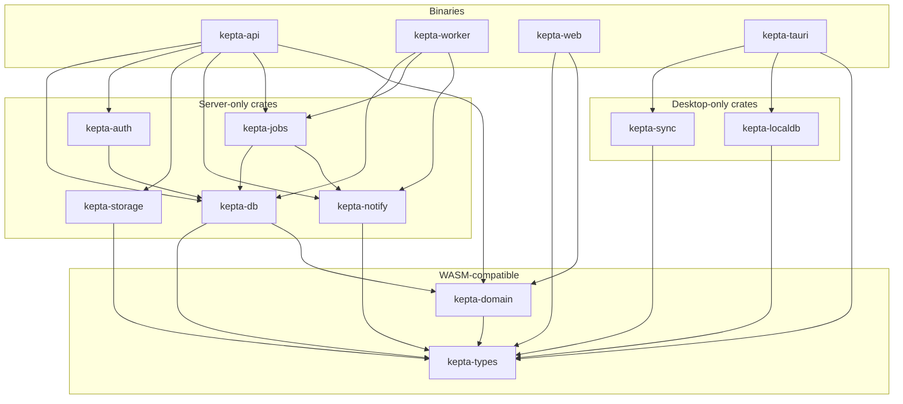
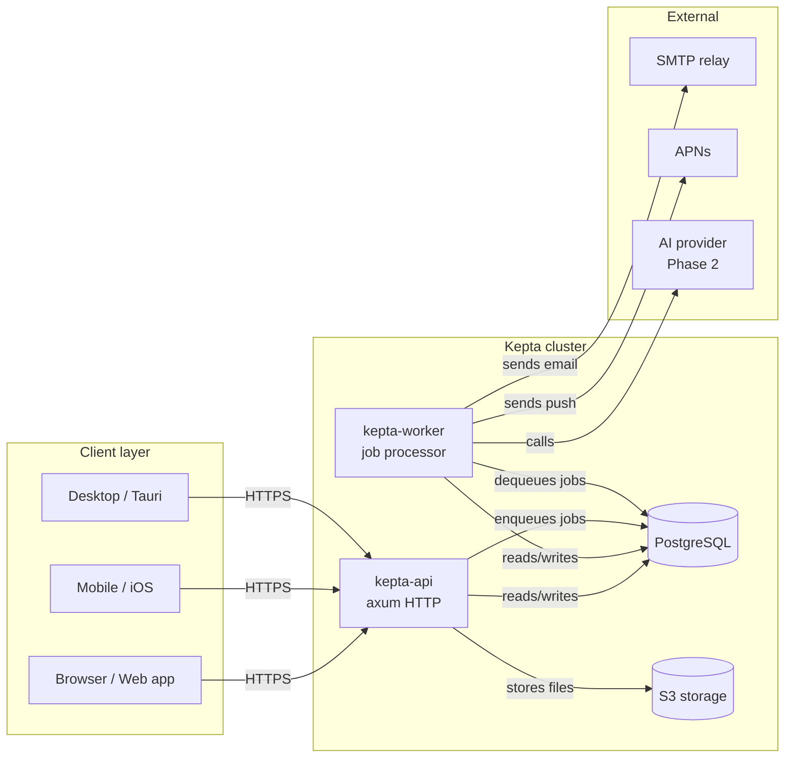
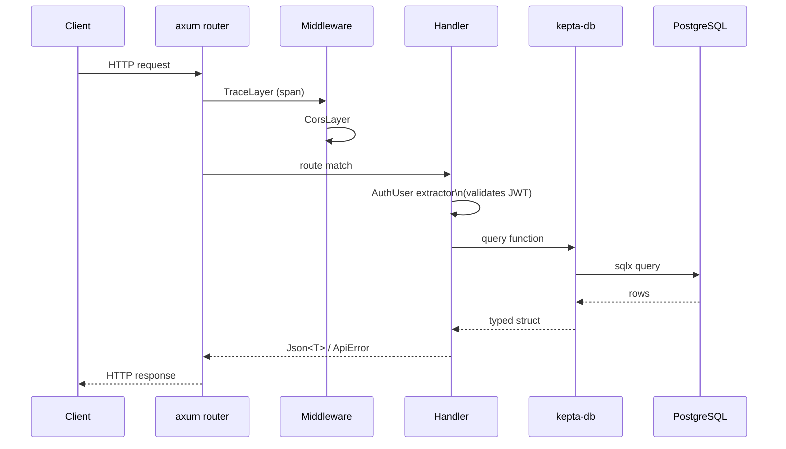

# Architecture

## Overview

Kepta is a Rust monorepo workspace. The backend splits into library crates (domain logic, data access, integrations) and binary services (API server, background worker). The frontend shares a single Leptos component library between the web app and the Tauri desktop shell.

## Workspace Layout

```
kepta/
├── crates/          # library crates
├── services/        # server binaries (API, worker)
├── frontend/        # Leptos web app + shared UI components
├── desktop/         # Tauri desktop shell
├── ios/             # Swift package (outside Cargo workspace)
├── docs/            # this directory
└── infra/           # Helm chart + k8s manifests
```

## Crate Dependency Graph



## Runtime Services



## HTTP Request Lifecycle



## Technology Stack

| Layer | Technology |
|-------|-----------|
| HTTP framework | axum 0.8 |
| Async runtime | tokio 1 |
| Database ORM | sqlx 0.9 (compile-time checked queries) |
| Database | PostgreSQL 18 |
| OpenAPI | aide 0.16 + schemars 1 |
| Auth | JWT (HS256, jsonwebtoken 10) + argon2 password hashing |
| TLS | rustls + aws-lc-rs |
| Object storage | object_store 0.13 (S3-compatible) |
| Email | lettre 0.11 (SMTP) |
| Notifications | APNs (HTTP/2), webhooks (HMAC-SHA256) |
| Serialization | serde + serde_json |
| Error handling | anyhow (internal) + thiserror (library errors) |
| Tracing | tracing + tracing-subscriber (JSON logs) |
| Frontend | Leptos 0.7 (Rust → WASM) |
| Desktop | Tauri + Leptos |
| iOS | Swift (native SwiftUI) |
| Config | config crate (env vars with `__` separator) |

## Key Design Decisions

**Single Postgres queue.** Jobs are stored in the `jobs` table and claimed with `SELECT … FOR UPDATE SKIP LOCKED`. No Redis dependency — one less moving part for self-hosters.

**Compile-time SQL.** `sqlx::query!` macros verify all SQL against the live schema at compile time. The `.sqlx/` offline cache is committed so CI doesn't require a running database.

**Shared type crate.** `kepta-types` is WASM-compatible and shared between the server and the Leptos frontend, eliminating drift between API request/response shapes.

**aws-lc-rs everywhere.** All TLS (sqlx, reqwest) uses rustls backed by aws-lc-rs. A single crypto provider avoids the rustls ambiguous-provider panic that occurs when ring and aws-lc-rs are both compiled in.
