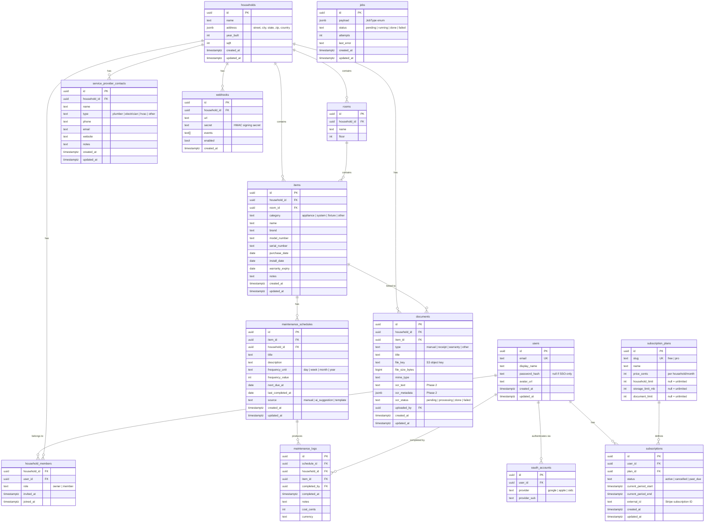

# Data Model

## Entity-Relationship Diagram

## Table Reference

### `users`
Central identity record. `password_hash` is null for accounts created exclusively via OAuth/OIDC.

### `oauth_accounts`
One row per linked OAuth provider. A user can have multiple (Google + Apple). `(provider, provider_sub)` is unique.

### `households`
A property. `address` is a JSONB object `{street, city, state, zip, country}`. `year_built` and `sqft` are nullable metadata used for AI suggestions (Phase 2).

### `household_members`
Join table between users and households. `role` is `owner` (can delete household, manage members) or `member` (read/write content). `joined_at` is null until an invitation is accepted.

### `rooms`
Optional sub-grouping within a household. Items may be assigned to a room but are not required to be.

### `items`
An appliance, system, or fixture within a household. `category` drives the AI suggestion prompt (Phase 2). `warranty_expiry` triggers the `warranty.expiring` notification event.

### `maintenance_schedules`
A recurring task attached to an item. `frequency_unit` + `frequency_value` define the recurrence (e.g. `month`/`3` = every 3 months). `next_due_at` is advanced by the worker after each completion. `source` distinguishes user-created schedules from AI-generated ones.

### `maintenance_logs`
Immutable completion record. `cost_cents` enables lifetime cost tracking per item.

### `documents`
File metadata; the actual bytes live in S3 at `file_key`. `ocr_*` columns are populated by the background worker in Phase 2.

### `service_provider_contacts`
A private, per-household contact book entry. Not shared across households or instances (Phase 3 introduces the federated `directory_providers` table).

### `webhooks`
Outbound webhook subscription. The worker delivers signed payloads to `url` for each event in `events[]`. The `secret` is used to sign with HMAC-SHA256 (`X-Kepta-Signature` header).

### `subscription_plans`
Seed data; two rows: `free` and `pro`. `null` limits mean unlimited.

### `subscriptions`
One per user. `external_id` holds the Stripe subscription ID in the hosted tier. Self-hosted instances leave this null.

### `jobs`
Postgres-backed job queue. Claimed with `SELECT … FOR UPDATE SKIP LOCKED`. No Redis required.

## Free Tier Limits

| Resource | Free | Pro |
|----------|------|-----|
| Households | 1 | Unlimited |
| Members per household | 2 | Unlimited |
| Documents per household | 25 | Unlimited |
| Storage per household | 500 MB | Unlimited |
| Webhooks | 0 | Unlimited |

Limits are enforced at the API level. Self-hosted instances set `BILLING_ENABLED=false` to disable all checks.
